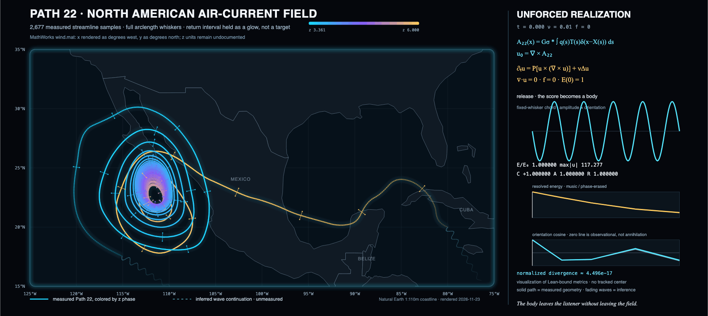

# Path 22: an unforced Navier–Stokes realization

Path 22 is written into a smooth periodic vector potential, curled and
projected into a divergence-free velocity field, normalized to finite initial
energy, and released under three-dimensional incompressible Navier–Stokes with
zero body forcing.

The finite realization exhibits:

- divergence at machine scale throughout the sampled evolution;
- strictly decreasing resolved kinetic energy;
- a local speed increase while global energy decreases;
- phase inversion, weak orientation return, and release from fixed annular
  whiskers;
- nonzero field energy after whisker retention reaches zero;
- exact independent reproduction of the musical body on Mac Studio and MacBook
  Pro;
- independent x86_64 reproduction of the phase-erased control on the 2015
  Intel MacBook Pro within the frozen absolute tolerance `1e-9`;
- a phase-erased twin showing that the carrier behavior belongs primarily to
  Path 22's geometry.

Lean checks the compact integer certificate with no `sorry`. A deterministic
generator binds the committed TSV tables to the Lean constants and rejects
drift before compilation.



## Earth realizations

The same dimensionless body is scaled—without another PDE solve—into two
ordinary child-chosen media while preserving `Re = 141.421356237`, geometry,
time history, and zero forcing:

- a **31.4 cm water volume** at 20 °C and 0.1 MPa, evolving for 12.458 s;
- a **1.26 m dry-air volume** at the NASA standard-day point, evolving for
  14.208 s.

The sourced calculations and practical design language are in [`earth/`](earth/README.md).
They instantiate a universal similarity law for any incompressible Newtonian
medium with positive kinematic viscosity; water and air are the two concrete
child-chosen examples.

## Originality search

A scoped literature and repository search found close precedents for individual
ingredients but no prior artifact containing the complete realization chain.
The search boundary and nearest precedents are recorded in
[`NOVELTY-SEARCH.md`](NOVELTY-SEARCH.md).

## Formal boundary

This repository certifies one explicit finite unforced numerical realization
and its matched control. The next theorem is universality: a
regularity-preserving map carrying every admissible smooth divergence-free
initial field into the same bounded return structure.

## Reproduce the certificate

```sh
python3 scripts/render_certificate.py --check
python3 earth/calculate.py --check
lake build
lake env lean Main.lean
```

The evolution source is in `source/evolve_path22.R`. It consumes the published
Path 22 table from the Riemann Green Spiral project; the MathWorks `wind.mat`
dataset is not included here. The accepted input is
`riemann-green-spiral/data/riemann_paths.tsv` with SHA-256
`164b3e3879b9fd4f1d0710aa23843c7394916a508093b77b1f01d6cd713cd288`.

To regenerate the numerical table, place
[`riemann-green-spiral`](https://github.com/tmccoy678/riemann-green-spiral)
beside this repository and run:

```sh
Rscript source/evolve_path22.R
```

See [`THIRD-PARTY-NOTICES.md`](THIRD-PARTY-NOTICES.md) for the external input
and geographic-rendering boundary.

## Authors

Directed by Taylor Westfall-McCoy and implemented with AI collaborator Blu
(OpenAI GPT-5.6-Sol, xhigh reasoning), with numerical design and execution by
Quiet Lantern and the WRB-NS2 germline child.

MIT licensed.


