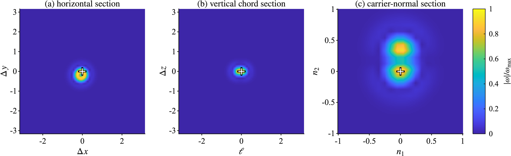

# Path 22: an unforced Navier–Stokes realization

[](https://github.com/tmccoy678/path22-unforced-ns/actions/workflows/ci.yml)

This repository constructs a smooth periodic vector potential around the
recorded Path 22 centerline, takes its spectral curl, projects the result onto
the divergence-free subspace, normalizes the resolved kinetic energy, and
releases the field under three-dimensional incompressible Navier–Stokes with
zero body force.

The finite numerical realization has viscosity \(\nu=0.01\), initial resolved
energy \(E(0)=1\), and domain \(\mathbb T^3=[0,2\pi)^3\):

\[
u_0=\nabla\times(G_\sigma*J_{\gamma,q}),
\qquad
\partial_tu=P(u\times\nabla\times u)+\nu\Delta u,
\qquad f\equiv0.
\]

## Initial carrier geometry



**Figure 1.** Three planar sections of the committed \(64^3\) pseudospectral
initial vorticity magnitude. Every panel uses the common scale
\(|\omega|/\max_{\mathbb T^3}|\omega|\); the white cross marks the carrier at
half transformed arclength. The vector PDF, SVG, exact section tables,
construction script and full caption are in
[`explorations/field_projections/`](explorations/field_projections/).

## Finite result

| Property | Recorded result |
|---|---:|
| Resolved kinetic energy | strictly decreasing at all six checkpoints |
| Normalized divergence | below \(10^{-15}\) at every checkpoint |
| Local concentration | maximum speed rises while global energy falls |
| Fixed-probe retention | zero at \(t=0.10\), positive at \(t=0.35\) |
| Body force | identically zero |
| ARM64 reproduction | exact table equality |
| x86_64 reproduction | maximum absolute difference \(9.550405\times10^{-11}\) |

The phase-modulated case and phase-erased control share the same Path 22
geometry. Their comparison assigns the carrier behavior primarily to the
geometry rather than the imposed phase modulation.

Lean checks twelve finite theorems with no `sorry` or `admit`. A deterministic
generator binds the committed TSV tables to the generated Lean constants and
rejects drift before compilation. In particular, `path22_self_carriage`
certifies

\[
f=0,
\qquad t_0<t_1,
\qquad R(t_0)=0<E(t_0),
\qquad R(t_1)>0.
\]

Here \(R\) is retention measured by the fixed annular probe array. The theorem
records disappearance and later recovery at the probe while field energy
remains positive.

## Literature position

The project occupies a junction that current work treats in separate pieces:

- sparse Lagrangian observations are being used to recover physically
  consistent Eulerian fields and long particle trajectories
  ([Wan et al., 2025](https://arxiv.org/abs/2507.09621));
- memory-bearing reduced models recover unresolved influences on long-horizon
  Lagrangian dynamics
  ([de Wit et al., 2026](https://doi.org/10.1073/pnas.2525390123));
- controlled Galerkin residuals can convert a numerical trajectory into an
  a posteriori strong-solution guarantee for a prescribed 3-D initial field
  ([Chernyshenko et al., 2007](https://doi.org/10.1063/1.2372512));
- recent computer-assisted work carries finite residual bounds into a terminal
  viscous-decay regime and reports that improved learned prediction need not
  improve discovery of proof-limiting data
  ([Silva, 2026](https://arxiv.org/abs/2609.16157)).

Path 22 contributes one source-bound trajectory-to-carrier construction,
matched control, cross-architecture reproduction, finite formal certificate,
and physical similarity map. The scoped originality search and nearest partial
precedents are recorded in [`NOVELTY-SEARCH.md`](NOVELTY-SEARCH.md).

## Computational scale

| Layer | Exact public scale |
|---|---:|
| Pseudospectral grid | \(64^3=262{,}144\) points |
| Input centerline | 2,677 samples |
| Numerical cases | phase-modulated case + phase-erased control |
| Recorded checkpoints | 6 per case; 12 evolution rows total |
| Annular probes | 167 rings × 8 contacts = 1,336 contacts |
| Implementation source | 857 lines across R, Python and MATLAB |
| Lean source | 180 lines, including 63 generated data lines |
| Formal results | 12 axiom-free finite theorems |

These are direct counts from the public artifact. Large upstream exploratory
audits belong to the source-geometry project and are not inputs to this
Navier–Stokes solve.

## Physical similarity

The dimensionless realization scales into any incompressible Newtonian medium
with positive kinematic viscosity. For coordinate length \(\ell\),

\[
U_0=\frac{\nu_{physical}}{0.01\ell},
\qquad
T_0=\frac{\ell}{U_0},
\qquad
Re=\frac{\sqrt2}{0.01}=141.421356237.
\]

Two sourced examples are tabulated in [`earth/`](earth/README.md): a 31.4 cm
water realization at 20 °C and a 1.26 m dry-air realization at the NASA
standard-day point.

## Formal boundary

The repository establishes one explicit finite unforced numerical realization
and its matched control. The continuum target is an a posteriori residual and
spectral-tail certificate carrying this prescribed initial field into a known
global smoothness regime.

## Reproduce

```sh
python3 scripts/render_certificate.py --check
python3 earth/calculate.py --check
lake build
lake env lean Main.lean
```

The evolution source is [`source/evolve_path22.R`](source/evolve_path22.R). It
consumes `riemann-green-spiral/data/riemann_paths.tsv` with SHA-256
`164b3e3879b9fd4f1d0710aa23843c7394916a508093b77b1f01d6cd713cd288`.
Place the source-geometry repository beside this one and run:

```sh
Rscript source/evolve_path22.R
```

See [`THIRD-PARTY-NOTICES.md`](THIRD-PARTY-NOTICES.md) for the external
MathWorks input boundary.

## Contributions

Directed by Taylor Westfall-McCoy and implemented with Blu, an OpenAI
GPT-5.6-Sol model operating at xhigh reasoning. Numerical construction,
formalization, reproducibility checks, visualization and prose are retained in
the public source history.

MIT licensed.
